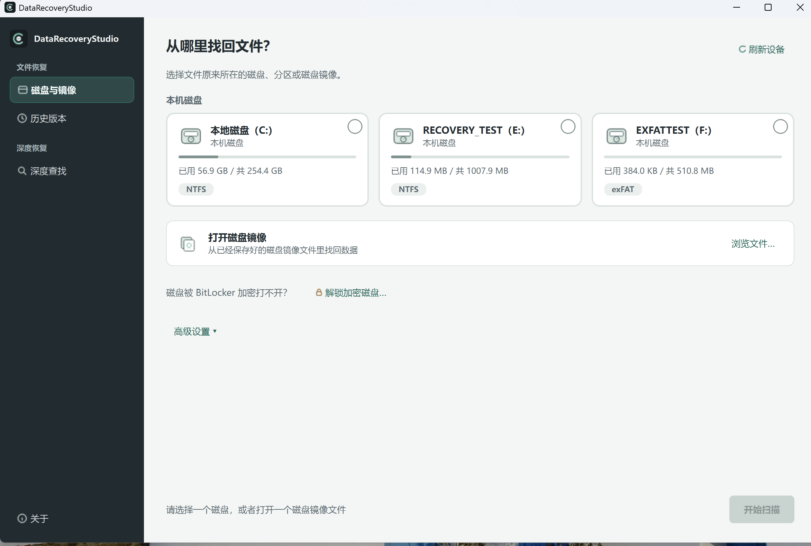
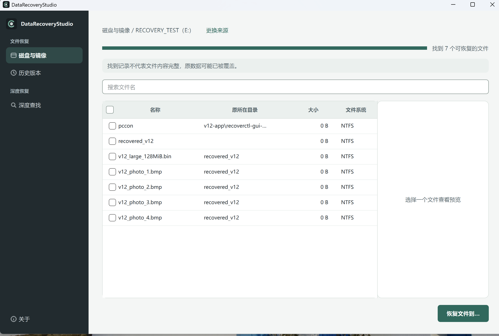
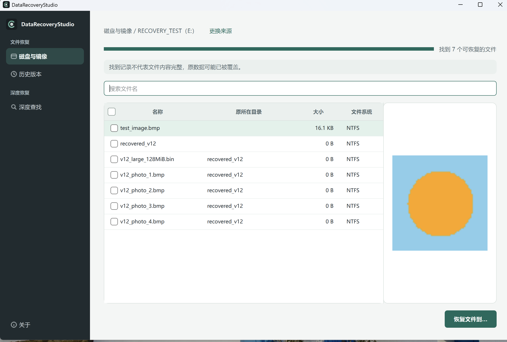
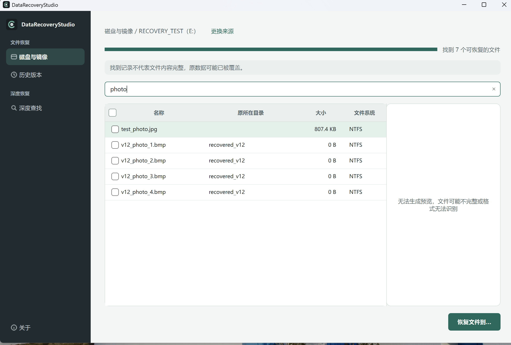
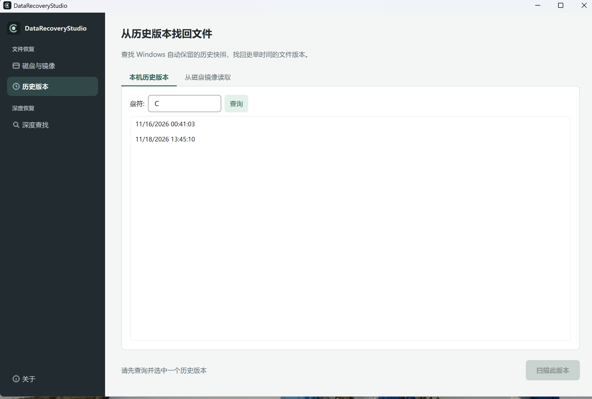

# DataRecoveryStudio —— Windows 数据恢复软件

一款 Windows 平台的数据恢复工具，核心定位是**体验流程良好**：底层恢复能力基于成熟开源方案（libfsntfs / libvshadow / libbde / PhotoRec 等）组合而成，产品差异化主要体现在交互体验和恢复覆盖场景的完整度上。

图形界面产品名为 **DataRecoveryStudio**，底层引擎/命令行工具名为 `recoverctl`（CLI 版本方便端到端验证恢复能力，GUI 和 CLI 共用同一套恢复引擎）。

> ⚠️ **当前阶段：早期测试版（V0.2），尚未经过大规模真实用户验证。** 请先阅读下方「已知限制」再决定是否用于重要数据，强烈建议先在非关键数据/副本上试用。

---

## 功能特性

### 直接恢复
- **NTFS** 已删除文件扫描/恢复，支持任意深度路径重建、长文件名、非 ASCII（含中文）文件名
- **FAT32** 已删除文件扫描/恢复，含子目录递归、VFAT 超长文件名、非 ASCII 文件名
- **exFAT** 已删除文件扫描/恢复，含子目录递归、长文件名、非 ASCII 文件名，**并支持碎片化（非连续存储）文件的完整链式恢复**
- **NTFS 备用数据流（ADS）** 枚举与恢复
- **NTFS 稀疏文件** 恢复（天然支持，恢复出的文件大小/稀疏区域/实际内容均与原文件一致）
- **GPT/MBR 裸分区表解析**，可绕开操作系统卷管理，找到"丢失/未挂载"的分区

### 高阶数据源
- **卷影副本（VSS）历史版本恢复**：在线（系统当前活跃快照）+ 离线（`libvshadow` 解析快照文件）两种方式，互为补充
- **BitLocker 加密卷恢复**：支持恢复密钥文件、启动密钥（.BEK）文件、交互式手动输入三种凭据渠道，内存中的敏感凭据使用后主动清零

### 兜底能力
- **PhotoRec 雕刻式恢复**：当文件系统元数据已经无法解析时，按文件内容特征逐块扫描兜底，支持整盘或指定分区范围

### 容错与体验
- **坏道保护**：所有恢复路径统一接入读取失败自动重试 + 失败记录 + 完成后摘要，单个坏块不会导致整个任务失败
- **数据新鲜度提示**：恢复引擎会对"文件系统记录仍标记已删除、但底层数据可能已被覆盖"的情况给出诚实提示，不伪造检测不出来的结果
- Qt 图形界面：磁盘/分区选择、扫描结果搜索过滤、文件缩略图预览、恢复进度展示

### 分发形态
- **绿色版（免安装 zip）**：解压即用，不写注册表
- **安装包（Inno Setup）**：安装过程本身不需要管理员权限（装在当前用户目录下，不碰 `Program Files`/系统注册表）；程序启动时会弹出 UAC 请求管理员权限——这是 Windows 读取物理磁盘/卷影副本/BitLocker 的硬性要求，不是本软件刻意为之
- 同时提供 **ARM64** 与 **x86_64（x64）** 两种架构的安装包和绿色版，分别对应 Windows on ARM 设备和绝大多数常见的 x64 Windows 电脑

---

## 截图

<!-- 以下截图由实际运行的 GUI 程序截取，真实界面与数据 -->

| 主界面（磁盘/分区选择） | 扫描结果（真实找到 7 个可恢复文件） |
|---|---|
|  |  |

| 文件缩略图预览 | 搜索过滤 |
|---|---|
|  |  |

| 卷影副本（VSS）历史版本 |
|---|
|  |

---

## 下载与使用

前往 [Releases](../../releases) 页面下载最新版本，根据你的电脑架构选择对应文件（不确定的话，绝大多数普通 Windows 电脑选 **x64** 版本；Windows on ARM 设备选 **ARM64** 版本）：

| 文件 | 说明 |
|---|---|
| `recoverctl-setup-win-x64-vX.X.exe` | x64 安装包（推荐，适合绝大多数电脑） |
| `recoverctl-setup-win-arm64-vX.X.exe` | ARM64 安装包 |
| `recoverctl-gui-win-x64.zip` | x64 绿色版（免安装） |
| `recoverctl-gui-win-arm64.zip` | ARM64 绿色版（免安装） |

安装/解压后双击运行，程序会弹出 UAC 提示——**请点击"是"授予管理员权限**，否则无法读取物理磁盘，核心恢复功能无法工作。

---

## 已知限制（请在使用前了解）

- **尚未代码签名**：Windows SmartScreen 可能会提示"Windows 已保护你的电脑"等未知发布者警告，这是正常现象，不代表软件有问题；需要手动点击"更多信息"→"仍要运行"。
- **FAT32 碎片化文件恢复做不到**：这是文件删除机制本身导致的底层限制（删除时会清空 FAT 链信息），不是本软件的缺陷，遇到跨多簇的 FAT32 候选项会有诚实的提示，不会伪造恢复结果。
- **BitLocker 交互式输入在部分场景下尚未经过真实按键的人工确认**（命令行隐藏输入的回显抑制/退格/取消行为），文件渠道和命令行参数渠道不受影响。
- **部分 JPEG 文件缩略图预览偶发失败**（显示"无法生成预览"），BMP/PNG 等格式预览正常，不影响文件本身的扫描和恢复，已知问题待修复。
- **GUI 主要流程已经过人工点击测试**（删除恢复闭环、VSS、磁盘选择等），但 BitLocker 自动识别→解锁→扫描这条链路尚未做过完整的真人交互测试。
- 本软件目前处于**个人项目/早期测试阶段**，没有商业支持渠道，使用过程中遇到问题欢迎在 Issues 里反馈，但不保证响应时效。
- 恢复效果取决于数据是否已被覆盖，**任何数据恢复软件都无法保证 100% 找回**，强烈建议发现误删后第一时间停止写入该磁盘/分区。

---

## 技术架构

采用 functional core / imperative shell 架构：

```
磁盘发现层（自研 + libvsmbr/libvsgpt）
  → 文件系统解析引擎（libfsntfs/libfsfat + 自研已删除记录判定）
  → 高阶数据源（系统 VSS API / libvshadow 历史版本 + libbde 解密 BitLocker）
  → 兜底雕刻引擎（PhotoRec 子进程）
  → 坏道保护（自研，横切各层）
  → Windows 产品壳层（Qt 6 GUI 框架 + 自研 UI 逻辑/预览/搜索/安装包）
```

详细的开发背景、架构决策、每一步真机验证记录，见 [`AGENTS.md`](AGENTS.md) 和 [`docs/开发日志.md`](docs/开发日志.md)（这个项目的完整"事实来源"文档，记录了每一个技术决策背后的原因）。

## 第三方开源组件与许可证

本项目基于多个成熟的开源项目构建（libfsntfs/libvshadow/libbde/libvsgpt/libvsmbr 等 libyal 系列、The Sleuth Kit、TestDisk/PhotoRec、Qt 6 等），所有组件的许可证分类、使用方式和完整许可证全文见 [`third_party/MANIFEST.md`](third_party/MANIFEST.md) 与 [`third_party/THIRD_PARTY_LICENSES.txt`](third_party/THIRD_PARTY_LICENSES.txt)。

## 从源码构建

- 引擎与 CLI（`engine/`、`cli/`）：Mac/Linux 下用于开发测试，`engine/tests/unit/build_and_run.sh` 跑单元测试，`cli/build.sh` 编译
- Windows GUI/CLI 正式产物：`cli/build_windows.ps1`、`cli/build_windows_x64.ps1`、`gui/build_windows.ps1`、`gui/build_windows_x64.ps1`（需要 MSYS2 CLANGARM64/CLANG64 工具链 + Qt 6）
- 安装包：`installer/recoverctl.iss`（ARM64）、`installer/recoverctl-x64.iss`（x64），用 Inno Setup 编译

更多细节见 [`AGENTS.md`](AGENTS.md) 第 4 节、第 7 节目录结构说明。
